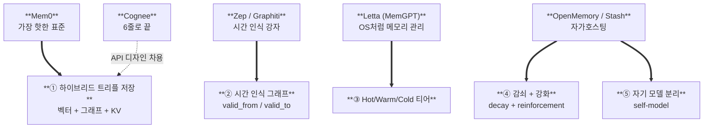

# Memtrail 로드맵

> 평생 쌓이는 자산이므로 서두르지 않는다. 각 Phase는 독립적으로 가치 있고, 다음 Phase 없이도 동작한다.

> 📊 인터랙티브 비주얼 버전: [`docs/index.html`](docs/index.html) (GitHub Pages 활성화 시 `https://eum-jium.github.io/memtrail/` 에서도 접근 가능)

---

## 한눈에 보기

### 벤치마킹 → Memtrail에 녹일 5가지 아이디어

2026-04-27, 메모리 레이어 분야 Big 5 (Mem0 / Zep / Letta / Cognee / OpenMemory·Stash) 비교 후 통합 설계.



### 7-Phase 타임라인

```mermaid
gantt
    title Memtrail 로드맵 (Phase 0/5 완료, Phase 1 다음 차례)
    dateFormat YYYY-MM-DD
    axisFormat %Y-%m

    section 완료
    Phase 0 기반 정리         :done,    p0, 2026-04-01, 27d
    Phase 5 클라우드 배포     :crit,    p5, 2026-04-28, 7d
    (Phase 5 는 2026-07-10 폐기 — 실 사용 0)

    section 다음
    Phase 1 그래프 레이어     :active,  p1, 2026-07-01, 90d

    section 예정
    Phase 2 시간 인식         :         p2, after p1, 90d
    Phase 3 메모리 티어       :         p3, 2027-01-01, 90d
    Phase 4 감쇠 + 강화       :         p4, after p3, 90d
    Phase 6 자기 모델 확장    :         p6, 2027-10-01, 90d
```

---

## Phase 0: 기반 정리 ✅ (2026-04 완료)

- [x] `memory_api` → `memex` 리네이밍
- [x] 코드 전용 GitHub repo 분리
- [x] 코드/데이터 분리 (환경변수 `MEMEX_DATA_DIR`)
- [x] 문서 체계 구축 (README, ARCHITECTURE, CONTRIBUTING)
- [x] 라이선스 (Apache 2.0)
- [x] 기존 Chroma DB 호환성 유지 (마이그레이션 0)
- [x] `re` import 누락 버그 수정

**산출물**: 깨끗한 시작점

---

## Phase 1: 그래프 레이어 (목표: 2026-Q3)

기존 벡터 검색 위에 **엔티티 + 관계** 레이어 추가.

### 작업 항목
- [ ] SQLite 그래프 스키마 설계 ([ARCHITECTURE.md#graph-store](ARCHITECTURE.md))
- [ ] 엔티티 추출 LLM 프롬프트 (Ollama qwen2.5)
- [ ] 관계 추출 + 정규화 (alias 처리)
- [ ] 기존 Chroma 데이터에서 그래프 백필 (1회 배치)
- [ ] MCP 도구 추가:
  - `traverse_graph(entity, depth=2)`
  - `find_related_entities(query)`
- [ ] 융합 검색 (vector + graph) 점수 함수
- [ ] 그래프 시각화 HTML (디버깅 용)

### 검증 기준
- 본인 대화에서 주요 엔티티 (프로젝트, 도구, 사람) 자동 추출
- "홈서버 프로젝트와 관련된 결정들" 같은 쿼리가 그래프 탐색으로 동작

**의존**: Phase 0 완료

---

## Phase 2: 시간 인식 (목표: 2026-Q4)

모든 사실에 `(valid_from, valid_to)` 부여.

### 작업 항목
- [ ] entities/relations 테이블에 시간 컬럼 추가
- [ ] 사실 모순 감지 알고리즘 (LLM 기반)
- [ ] 자동 `valid_to` 업데이트 로직
- [ ] 시점 기준 쿼리 API (`as_of=2024-06-01`)
- [ ] 변화 추적 도구: `get_fact_history(key)`
- [ ] 시간 인식 융합 검색 (현재 시점 가중치)

### 검증 기준
- "2024년의 내 개발 환경"과 "현재 개발 환경"이 다르게 답변됨
- 사실 변경 시 이력이 보존됨

**의존**: Phase 1

---

## Phase 3: 메모리 티어 (목표: 2027-Q1)

Hot / Warm / Cold 계층 구현.

### 작업 항목
- [ ] 티어별 저장소 추상화 (StorageBackend interface)
- [ ] Hot tier: in-memory LRU 캐시
- [ ] Warm tier: 현재의 Chroma + SQLite
- [ ] Cold tier: Cloudflare R2 또는 Google Drive 백엔드
- [ ] 자동 티어 이동 cron job
- [ ] 검색 시 티어 순회 로직
- [ ] 티어 통계 대시보드 (CLI)

### 검증 기준
- 1년 이상 미사용 메모리가 Cold로 자동 이동
- 검색 시 Hot 위주, 필요 시 Warm/Cold fallback
- 디스크 사용량 안정적

**의존**: Phase 2

---

## Phase 4: 감쇠 + 강화 (목표: 2027-Q2)

생물학적 기억 모방.

### 작업 항목
- [ ] 메모리 메타데이터에 `last_accessed`, `access_count` 추가
- [ ] 감쇠 함수 구현 (지수 감쇠, 반감기 설정)
- [ ] 검색 시 강화 (access_count++)
- [ ] 망각 후보 선정 + 사용자 승인 워크플로우
- [ ] 감쇠/강화 통계 시각화

### 검증 기준
- 자주 회상되는 메모리가 검색 상위에 유지
- 1년 이상 미회상 + 낮은 점수 메모리가 망각 후보로 표시

**의존**: Phase 3 (티어 시스템)

---

## ~~Phase 5: 클라우드 배포~~ (2026-07-10 폐기)

**요약**: 2026-04-28~05월 사이에 Railway HTTP MCP + OAuth 2.0 (DCR + PKCE) 로 구현 완료 → 실 사용 0 로 판단, 2026-07-10 Railway 프로젝트 내림.

**폐기 이유**:
- 실 사용 0 — 띄워 둔 동안 쓰이지 않아 유지 가치 없음.
- 단일 사용자 · 단일 머신 사용에 클라우드 hop 은 latency + 유지비만 늘림.
- 미래에 여러 device 접근이 필요해지면 별도 아키텍처로 재검토 (P2P sync, 별 호스팅 등).

Cold 티어용 저비용 스토리지 (R2 등) 는 [Phase 3 메모리 티어](#phase-3-메모리-티어-목표-2027-q1) 안에서만 검토.

---

## Phase 6: 자기 모델 확장 (목표: 2027-Q4)

5개 프로필 → 풍부한 자전적 모델로.

### 작업 항목
- [ ] `narrative.md` — 시간 순 자전적 서사 자동 생성
- [ ] `timeline.md` — 주요 사건 연표
- [ ] `relationships.md` — 인물 관계망 (그래프와 연동)
- [ ] `goals.md` — 단기/장기 목표 추적
- [ ] `decisions.md` — 주요 결정 + 근거 + 결과
- [ ] 자기 모델 변화 시각화 (시간에 따라 어떻게 변했나)

### 검증 기준
- "지난 1년 동안 내가 어떻게 변했는가?" 질의에 의미 있는 답변
- 결정 시 과거 결정 근거를 회상하여 일관성 유지

---

## Phase 7+: 장기 비전

순서/시점 미정. 가능성 있는 방향:

### 멀티 디바이스 동기화
- 노트북 + 데스크탑 + 모바일에서 동시 사용
- CRDT 또는 vector clock 기반 충돌 해결

### 외부 시스템 통합
- Obsidian / Logseq 연동 (양방향 sync)
- Apple Notes / Notion 흡수
- 캘린더 / 메일 컨텍스트 흡수

### GraphRAG 본격 통합
- Microsoft GraphRAG 패턴 적용
- 커뮤니티 검출 + 요약

### 멀티 사용자 (오픈소스화 시)
- 사용자별 격리된 메모리
- 권한 / 공유 모델

### 임베딩 진화
- 더 좋은 한국어 모델 (e5-base → ?)
- 마이그레이션 전략 (재임베딩)

---

## Phase별 성공 지표

| Phase | 정량 지표 | 정성 지표 |
|---|---|---|
| 0 | clean repo, docs ≥ 5개 | "프로젝트가 보이기 시작" |
| 1 | 엔티티 ≥ 100개 자동 추출 | "그래프 시각화에서 본인 발견" |
| 2 | 사실 변경 추적 ≥ 10건 | "과거 vs 현재 차이 답변 가능" |
| 3 | Cold 티어 이동 자동화 | "디스크 부담 해소" |
| 4 | 자주 쓰는 메모리 강화 | "검색 결과 점점 좋아짐" |
| 5 | 웹/모바일에서 작동 | "어디서나 메모리 접근" |
| 6 | 자전적 서사 자동 생성 | "내 인생을 보는 도구" |

---

## 진행 상황 추적

GitHub Projects board: (Phase 1 시작 시 생성 예정)

라벨: `phase-1`, `phase-2`, ... 으로 이슈 분류.

---

*원칙: 평생 쌓이는 자산이므로 처음부터 제대로 짓는다.*
